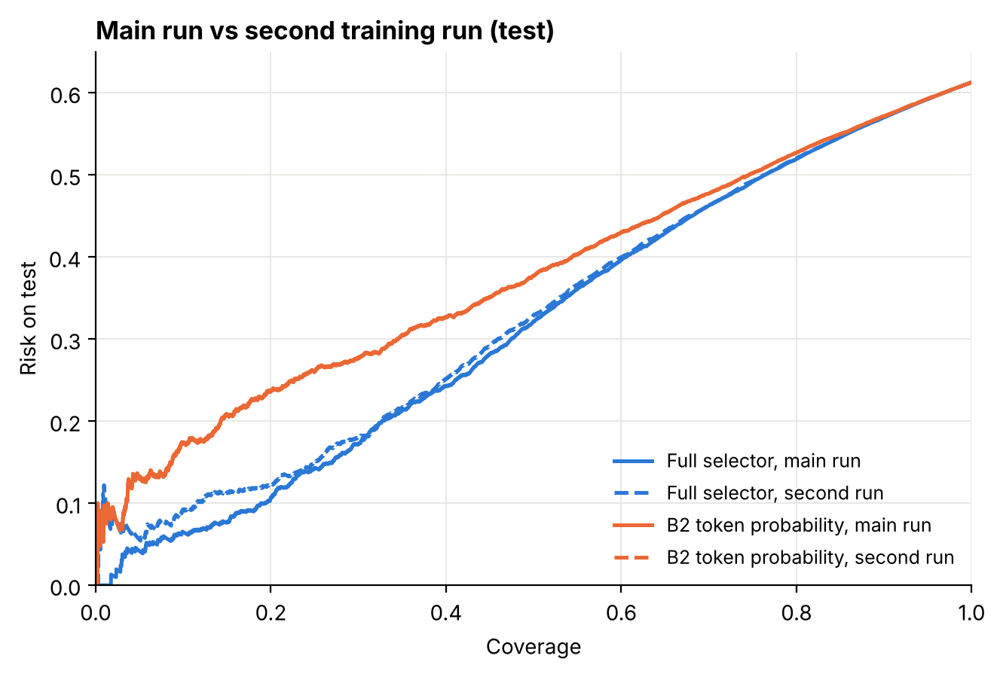

# Answer or Retake

IE4422 group project, NTU. A blind user takes a photo and asks a question out loud. A frozen Qwen2-VL-2B answers it, and a small selector decides whether to speak the answer or stay quiet. When it stays quiet, a flaw head gives a retake tip such as "hold the phone still" or "turn on a light".

## What we did

- Ran the frozen VLM once on VizWiz: 17,445 train, 3,078 of our own validation, and 4,319 test questions (the official val set). We saved each answer, its token log-probs, and the image, question and answer embeddings.
- Trained the selector, a one-hidden-layer MLP on those embeddings plus the log-probs. Layer and size were picked on our validation set, thresholds were set there too, and test was used once.
- Compared against four baselines: always answer (B1), the VLM's own token probability (B2), a prompt that asks the VLM to say "unanswerable" (B3), and the flaw head alone (B4). Also ran photo-only and photo + question versions of the selector.
- Checked the whole pipeline: splits, labels, score files and every number in the proposal.
- Trained the selector a second time from the saved features, with its own settings search, to see how stable the results are.

No data is committed. See [`data/README.md`](data/README.md) for what goes where.

## Run

```
pip install -r requirements.txt
python scripts/check_pipeline.py --data data   # checks
python scripts/train_selector.py --data data   # second training run (about 3 min on a laptop CPU)
python scripts/compare_runs.py --data data     # main run vs second run
```

Plots: `notebooks/extra_analysis.ipynb` (reads the same `data/` folder, saves to `results/figures/`).

## Results

**Checks:** all 17 pass, and all 27 numbers in the proposal come out the same from the saved files ([report](results/checks_report.md)). No photo is in two splits, labels match the raw human answers, and every test decision uses thresholds set on our validation set.

**Selector, test set** ([details](results/compare_runs.md)):

| AURC on test (lower is better) | main run | second run |
|---|---|---|
| Full selector | 0.317 | 0.327 |
| Log-probs only | 0.366 | 0.373 |
| B2 token probability | 0.373 | 0.373 |
| Photo + question | 0.372 | 0.383 |
| Photo only | 0.445 | 0.451 |

- The full selector beats B2 in both runs (-0.056 and -0.046 AURC; both 95% CIs below zero).
- The two runs rank questions almost the same way (rank correlation 0.97) and make the same answer/quiet call on 93% of questions at the 20% target.
- Photo + question and B2 are a tie.
- At the 20% target, test risk is 23.7% in the main run and 25.6% in the second, so expect about 2 points of run-to-run variation.



## Layout

```
src/answer_retake/   metrics, data loading, selector
scripts/             the three steps above
notebooks/           plots only
results/             reports and figures (small files only)
```
